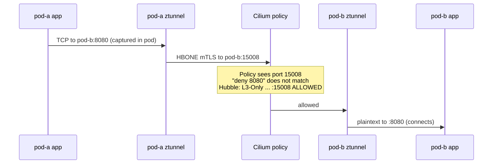
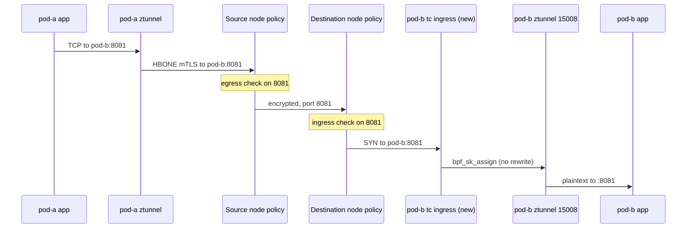
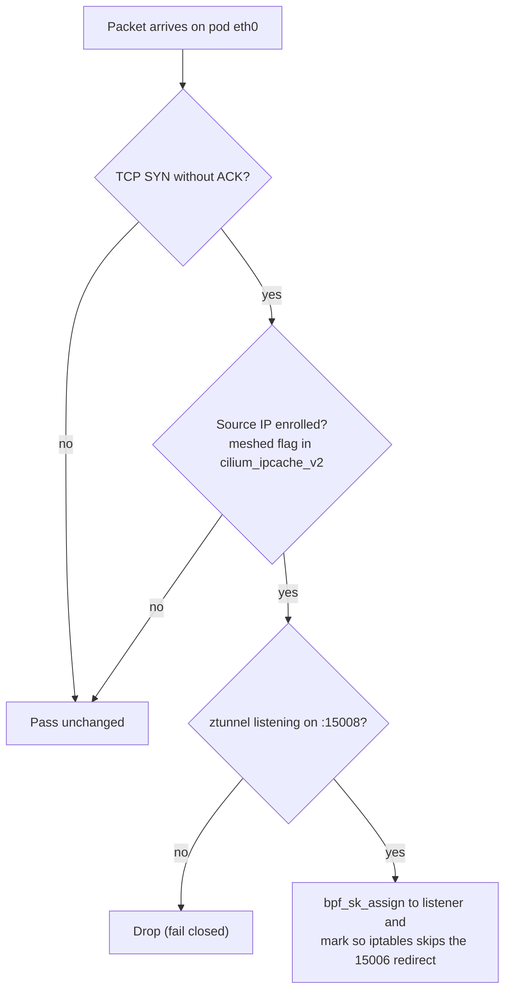
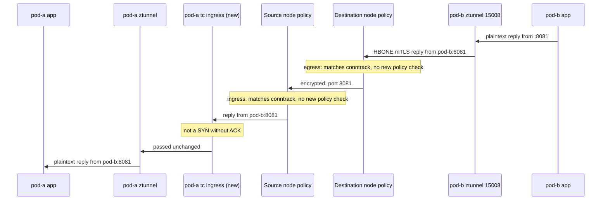
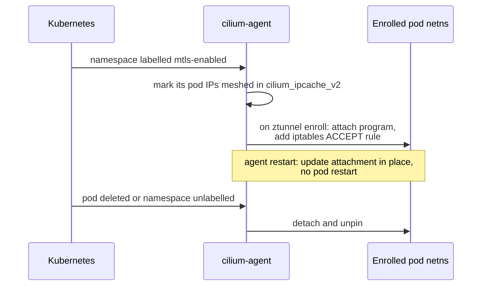
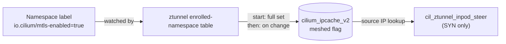

# CFP-49560: L4 Network Policy for ztunnel mTLS Traffic

**SIG: sig-policy**

**Begin Design Discussion:** 2026-10-21

**Cilium Release:**

**Authors:** Alexander Lew (alexanderlew@microsoft.com), Tamilmani Manoharan (tamanoha@microsoft.com)

**Status:**

## Summary

When ztunnel mTLS is enabled, L4 network policy does not apply to traffic
between enrolled pods. ztunnel sends all encrypted traffic to port 15008, so
Cilium's policy checks see 15008 instead of the application port. This CFP
proposes that ztunnel keep the application port on the encrypted connection,
and that Cilium hand the allowed connection to ztunnel inside the destination
pod with a small BPF program. Policy is still enforced by the existing
datapath, unchanged.

## Motivation

Consider a namespace labelled `io.cilium/mtls-enabled=true` with this policy:

```yaml
apiVersion: cilium.io/v2
kind: CiliumNetworkPolicy
metadata:
  name: deny-pod-a-egress-to-pod-b-8080
spec:
  endpointSelector:
    matchLabels: {role: pod-a}
  egressDeny:
  - toEndpoints:
    - matchLabels: {role: pod-b}
    toPorts:
    - ports: [{port: "8080", protocol: TCP}]
```

Without ztunnel, pod-a cannot reach pod-b:8080. With ztunnel, it can:



The real port exists only inside the encrypted HBONE CONNECT request, so the
datapath cannot see it. Ingress policy on the destination is bypassed the same
way. Users who turn on mTLS silently lose L4 policy for enrolled pods.

## Goals

* Enforce existing L4 ingress and egress policy on ztunnel-encrypted TCP
  traffic between enrolled pods
* Show the application port, not 15008, in Hubble
* No change to the CiliumNetworkPolicy API
* Keep traffic encrypted from pod to pod
* Opt-in; no behavior change when disabled
* Keep working across cilium-agent restarts without restarting pods

## Non-Goals

* L7 policy on encrypted traffic
* UDP
* Waypoints, ClusterMesh and multi-network
* Replacing ztunnel's in-pod iptables rules

## Proposal

### Overview

Two opt-in changes:

1. **ztunnel:** open the encrypted (outer) connection to `<pod-ip>:<app-port>`
   instead of `<pod-ip>:15008`. Prototype flag: `PRESERVE_HBONE_DEST_PORT=true`.
2. **Cilium:** `--enable-ztunnel-l4-policy` attaches a BPF program inside
   each enrolled pod that hands the encrypted connection to ztunnel's 15008
   listener. It runs after policy and does not rewrite the packet.

An allowed connection from pod-a to pod-b:8081:



The handoff is required. With the ztunnel change alone, denies are enforced
but every allowed enrolled connection fails, because the encrypted SYN hits
ztunnel's in-pod redirect for plaintext inbound traffic (15006).

### Datapath

New program `cil_ztunnel_inpod_steer`, attached to `eth0` ingress inside
each enrolled pod's network namespace with the loader's existing helper (tcx
when enabled and supported, else legacy tc):



Only the SYN needs this. After it, the kernel tracks the connection by its
real ports. No headers are rewritten, so no reverse NAT state is needed.
No new map: enrollment is a new `meshed` flag in the existing `cilium_ipcache_v2`.

#### Return traffic

Replies to the allowed connection above:



Same as today: replies ride the conntrack entries created by the SYN. pod-b's
new program is not on this path because it runs on ingress only. pod-a is also
enrolled, so its copy sees every reply and passes it.

### Control plane



`--enable-ztunnel-l4-policy` requires `--enable-ztunnel`. Rollout order:
enable the Cilium flag first, then ztunnel preserve-port. The reverse order
breaks allowed enrolled traffic until both are on.

#### Enrollment in ipcache

Each `cilium_ipcache_v2` entry has a `meshed` flag, set for the IPs of all
enrolled pods across all nodes. Each node's agent sets it in its own ipcache.



Writes are event-driven; there is no periodic resync.

- **Source:** the ztunnel enrolled-namespace table, from the namespace label.
  The ipcache knows each pod IP's namespace, so it flags enrolled pod IPs on
  every node, local or remote.
- **Agent start:** once the table is ready, flag every IP in an enrolled namespace.
- **Updates:** a namespace is labelled or unlabelled (its pod IPs are flagged or
  cleared), or a new pod IP in an enrolled namespace is added to the ipcache.
- **Agent stop:** flags are kept in the pinned ipcache, so steering works while
  the agent is down. The next start sets them again.

The program reads the ipcache on each SYN: source IP lookup in
`cilium_ipcache_v2`. Meshed: hand off to ztunnel. Otherwise: pass unchanged.
This is independent of ztunnel's enroll event, which attaches the program and
adds the iptables rule.

## Impacts / Key Questions

### Impact: Linux 5.7+

`bpf_sk_assign` at tc ingress needs 5.7. ztunnel's listener uses SO_REUSEPORT
by default (`INPOD_PORT_REUSE`), which `bpf_sk_assign` accepts only from 6.6,
so older kernels need `INPOD_PORT_REUSE=false`. Below 6.6 with the default,
the steer fails closed and enrolled allowed connections are dropped. tcx needs
6.6; on older kernels the agent falls back to legacy tc.

### Impact: BPF inside pod network namespaces

This is new for Cilium: one tc attachment per enrolled pod. Cleanup on pod
delete, agent restart and endpoint ID reuse must be robust. Policy is still
decided on the host, so tampering inside the pod (for example with NET_ADMIN)
should only break that pod's own inbound mTLS, not bypass policy.

There is already precedent for adding iptables rules to the pod/modifying
the pod netns when ztunnel is enabled (ex: marking the connection to know if it
has been handled by ztunnel, redirecting outbound traffic to ztunnel etc.).

### Impact: Trust in the source ztunnel

Policy trusts that the outer port matches the port inside the CONNECT request.
A compromised ztunnel already sees plaintext today. The receiving ztunnel
could reject a mismatch as defense in depth.

### Impact: Performance

Only SYNs do map and socket lookups; other packets pass after a flag check.

### Impact: Failure behavior

Expected behavior with both changes on unless stated. "Enrolled" means the
pod's namespace is labelled and ztunnel captures its traffic.

| Scenario | Expected behavior |
|---|---|
| **Agent and ztunnel** | |
| cilium-agent down: existing connections | Traffic continues as normal; the program and ipcache stay in place. Once ztunnel restarts (it depends on the agent's ZDS socket, same as today), enrolled traffic fails until the agent returns |
| cilium-agent down: new connection between enrolled pods | Allowed and denied as before cilium-agent went down, using the last policy and ipcache. Fails once ztunnel restarts, as above |
| cilium-agent down: CNP created | Not enforced on that node until the agent returns, same as today |
| cilium-agent down: new pod on that node | Does not start until the agent returns (CNI needs the agent), so no pod runs unsteered |
| cilium-agent down: new enrolled pod on another node | This node's ipcache is stale; its SYNs should not be handed off and should fail until the agent returns |
| cilium-agent restart | Attachments updated in place (tcx links kept, legacy tc filters re-pointed). No pod restart; existing and new connections continue as normal and policy holds throughout |
| Deny CNP added while connections are open | Existing connections on the denied port are cut, including established mTLS sessions: packets from the client are dropped on the real port while replies from the server still pass. New connections are dropped. Plaintext connections stall and resume if the deny is removed; encrypted ones are closed by ztunnel and must reconnect |
| ztunnel down or restarting | Fails closed: inbound enrolled SYNs are dropped and outbound from enrolled pods is refused, same as today, until ztunnel is back. In-flight enrolled connections through that ztunnel are closed. Denied traffic stays denied |
| Program attach fails at enroll | Enrollment fails and the pod is not handed to ztunnel; the agent logs the error and counts it in the `steering_failed` enrollment-failure metric. Its in-pod rules are already in place, so its traffic fails closed (inbound reset, outbound refused). Other pods in the namespace still enroll, though one may wait for a retry if the failing pod is handled first. Retried with backoff (up to 60s), so the pod enrolls once the cause is fixed |
| **Kernel** (`INPOD_PORT_REUSE` is an env var on the ztunnel DaemonSet container, default `true`) | |
| Below 5.7 | Agent should fail to start with the flag on (program cannot load). Not supported. |
| 5.7 to 6.5, ztunnel `INPOD_PORT_REUSE=true` (default) | Handoff fails closed: allowed enrolled connections to pods on that node are dropped. Denies and non-enrolled traffic are unaffected |
| 5.7 to 6.5, ztunnel `INPOD_PORT_REUSE=false` | Works. Legacy tc is used even if tcx is enabled |
| 6.6 and later | Works with either ztunnel `INPOD_PORT_REUSE` setting; tcx when enabled |
| Mixed kernels in one cluster | Only connections to enrolled pods on nodes that fail the rows above are affected; connections from those pods still work. Hubble shows the failed SYNs as allowed and forwarded, since the drop happens in the pod |
| netkit | Not supported; attach should fail, so enrollment should fail as above |
| **Migration and rollback** | |
| Non-enrolled pod to enrolled pod | Source is not enrolled, so the SYN passes unchanged to ztunnel's plaintext inbound redirect. Policy applies on the real port, same as today |
| Enrolled pod to non-enrolled pod | ztunnel sends plaintext to the real port. Policy applies on the real port, same as today |
| Namespace being enrolled | Until the pod is enrolled and its IP is marked meshed in every node's ipcache, some connections should fail and be retried. Today a similar window exists for not-yet-enrolled destinations |
| Namespace unenrolled | Program, in-pod rules and listener removed; traffic is plaintext on the real port with policy enforced. No connections fail during the change and denies hold |
| Cilium flag on, ztunnel preserve-port off | Same as today: the outer port is 15008, so deny rules on the app port are bypassed for encrypted traffic, and allow-lists that do not include 15008 drop it (fails closed). Turning preserve-port on takes effect when ztunnel restarts; no agent restart is needed |
| ztunnel preserve-port on, Cilium flag off (or not yet on the destination node) | Denies enforced, but allowed enrolled connections to those pods fail: the encrypted SYN hits the plaintext redirect |
| Mixed ztunnel versions during rollout | Connections from ztunnels without preserve-port use 15008, as in the flag-on, preserve-port-off row: denies on the app port are bypassed, and if port 15008 is not allowed, we drop. Connections from updated ztunnels are enforced on the real port, including to nodes whose ztunnel is not yet updated |
| Rollback | Turn off ztunnel preserve-port first, then the Cilium flag. On start with the flag off, the agent removes the program (tcx links and legacy tc filters) and its iptables ACCEPT rule from enrolled pods |

### Alternatives considered

With preserve-port, the encrypted SYN reaches the destination pod addressed to
the app port, not 15008. The handoff is whatever delivers that connection to
ztunnel's 15008 listener after ingress policy, instead of the app or ztunnel's
plaintext redirect (15006), while replies still match the client's connection.

Options considered, each paired with ztunnel preserve-port:

| Option | Handoff | Main concern |
|---|---|---|
| Preserve-port only | none | Allowed enrolled traffic breaks |
| DSCP + REDIRECT | BPF sets DSCP, in-pod iptables REDIRECT | Agent restart race; DSCP as a signal |
| A' | CT bit + DSCP + in-pod TPROXY | Changes `bpf_lxc` and CT state |
| D | `bpf_lxc` DNAT to 15008 + reply map | Reverse NAT state to manage |
| E | BPF match in iptables + TPROXY | Runs BPF from iptables (new for Cilium) |
| **F (this CFP)** | tc + `bpf_sk_assign` in pod | Linux 5.7+; BPF in pod netns |

## Open Questions

* Below 6.6, how should Cilium and ztunnel agree on `INPOD_PORT_REUSE=false`?

## Future Milestones

* Final flag names and kernel feature probe
* Unit, privileged BPF and connectivity tests in CI


