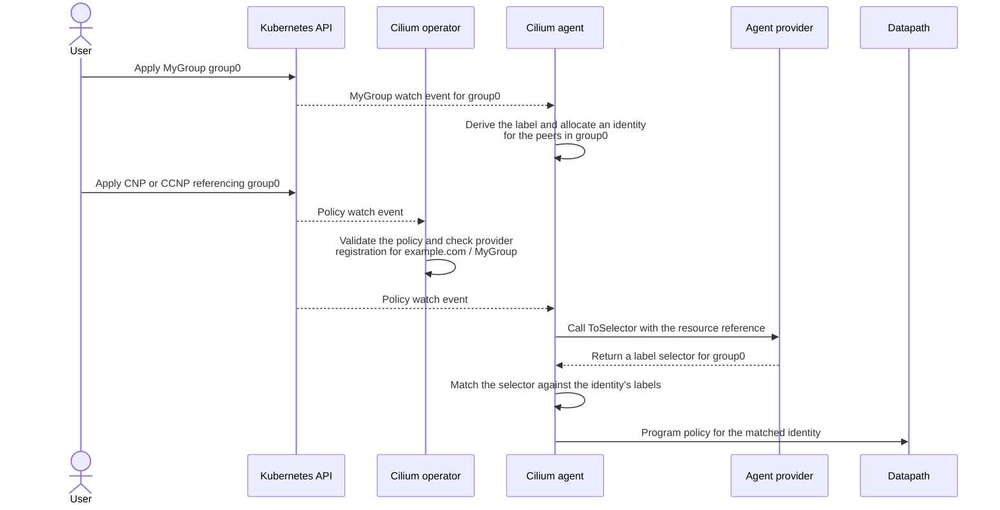

# CFP-50262: policy: Generic API extension point for CNP/CCNP

**SIG: SIG-Policy**

**Begin Design Discussion:** 2026-11-24

**Cilium Release:** 1.21

**Authors:** Yutaro Hayakawa <yutaro.hayakawa@isovalent.com>

**Status:** Draft

## Summary

This CFP proposes a generic API extension point for Cilium Network Policy (CNP)
and Clusterwide Cilium Network Policy (CCNP). It allows downstream distributors
to define custom L3 policy peers through Kubernetes resource references. The
extension point consists of a new resource reference field in CNP and CCNP and
a mechanism for registering providers with hooks in the agent or operator.

## Motivation

Downstream Cilium distributors sometimes need to extend the CNP and CCNP APIs
for distribution-specific integrations. Extending the API types requires changes
to internal types such as [Rule][rule] in the `api` package, as well as to the
relevant [validation][validation], [sanitization][sanitization], and
[conversion][conversion] logic. Keeping those changes in sync with upstream
creates a significant maintenance burden for downstream distributors.

[rule]: https://github.com/cilium/cilium/blob/ad7c0f73cb7380fba834fa3599d39e98d08b5b29/pkg/policy/api/rule.go#L71
[validation]: https://github.com/cilium/cilium/blob/ad7c0f73cb7380fba834fa3599d39e98d08b5b29/pkg/policy/api/rule_validation.go#L37
[sanitization]: https://github.com/cilium/cilium/blob/ad7c0f73cb7380fba834fa3599d39e98d08b5b29/pkg/policy/api/rule_validation.go#L101
[conversion]: https://github.com/cilium/cilium/blob/ad7c0f73cb7380fba834fa3599d39e98d08b5b29/pkg/policy/utils/parserules.go#L12

## Goals

* Allow downstream Cilium distributors to define custom L3 policy peers through
  Kubernetes resource references.
* Allow downstream Cilium distributors to register providers at startup to
  supply the logic needed to interpret those references.

## Non-Goals

* Support for arbitrary policy extensions, such as new L4 or L7 policy rules.
* Support for out-of-tree or dynamic provider registration. Providers must be
  registered during operator and agent initialization using Hive cells or
  `init()`.
* Backward compatibility guarantees for the internal provider interface.

## Proposal

### Overview

This proposal adds four components.

1. A new field in CNP and CCNP that references a Kubernetes resource by API
   group, kind, and name.
2. A registration mechanism that allows providers to register with hooks in the
   agent or operator.
3. An agent
   [ToSelector](https://github.com/cilium/cilium/blob/ad7c0f73cb7380fba834fa3599d39e98d08b5b29/pkg/policy/types/selector.go#L140-L163)
   extension point where a provider converts a resource reference to an internal
   label selector.
4. An operator
   [validator](https://github.com/cilium/cilium/blob/ad7c0f73cb7380fba834fa3599d39e98d08b5b29/operator/pkg/networkpolicy/validator.go#L33)
   extension point for checking whether a resource reference is valid.

#### Typical use case

In this example, a downstream controller in the agent allocates a security
identity for the peers in a `MyGroup` resource named `group0` in the
`example.com` API group. The identity has the label
`mygroup:policy.example.com/resource-name=group0`. A CNP or CCNP references
`group0` to select those peers.



### Resource reference in CNP/CCNP

There are two ways to add support for arbitrary resource references to the API.

#### Option 1 (preferred) — Extend the existing `toGroups` and `fromGroups` fields

Add a `groupRef` field to the existing [external-group
API](https://docs.cilium.io/en/stable/security/aws/).

```yaml
ingress:
- fromGroups:
  - groupRef:
      group: example.com
      kind: MyGroup
      name: group0
  - groupRef:
      group: example.com
      kind: MyGroup
      name: group1

egress:
- toGroups:
  - groupRef:
      group: example.com
      kind: MyGroup
      name: group0
  - groupRef:
      group: example.com
      kind: MyGroup
      name: group1
```

The external-group API was introduced to support third-party integrations, so
this extension fits its original purpose. Support for additional public cloud
providers could still be added through dedicated fields such as `gcp` or
`azure`. Only proprietary extensions from downstream distributors would use
`groupRef`.

##### Groups without a `CiliumCIDRGroup` mapping

The existing external-group API assumes that every group maps to a
`CiliumCIDRGroup`. Our initial use case needs no such mapping, so this proposal
extends the API to support groups without one. Groups referenced through
`groupRef` fall into this category. A future proposal could add an opt-in
mechanism if a use case requires mapping a `groupRef` to a `CiliumCIDRGroup`.

##### Namespaced resource support

The resource must be cluster-scoped. As our initial use case doesn're require
namespaced resources. We omit support for namespaced resources in this proposal
for the sake of simplicity. It can be added later if a use case requires it. In
that case, we need a separate discussion on whether we should let users to
specify namespace for namespaced CNP.

#### Option 2 — Introduce a new policy peer type

Add resource reference fields directly under `ingress`, `egress`, `ingressDeny`,
and `egressDeny`.

```yaml
ingress:
- fromL3Refs:
  - group: example.com
    kind: MyGroup
    name: group0
  - group: example.com
    kind: MyGroup
    name: group1

egress:
- toL3Refs:
  - group: example.com
    kind: MyGroup
    name: group0
  - group: example.com
    kind: MyGroup
    name: group1
```

The `fromL3Refs` and `toL3Refs` fields accept references to arbitrary named
resources. The `L3` in their names indicates that the fields are used only to
resolve L3 peers. This restriction allows these fields to be mutually exclusive
with other L3 peer fields, such as `toEndpoints`, `fromEndpoints`, `toCIDRSet`,
and `fromCIDRSet`, following the [existing L3 peer validation][ref].

This option is easier to implement than Option 1 and preserves the existing
API semantics. It adds a second integration point alongside the external-group
API.

[ref]: https://github.com/cilium/cilium/blob/5ec5829ed8c5b06f488754d5b675f182fcd6183e/pkg/policy/api/rule_validation.go#L256-L264

### Provider conventions

#### Provider registration

Providers must be registered during operator and agent startup using Hive cells
or `init()`. Each provider is identified by the API group and kind it handles.
Registration is static.

#### Agent ToSelector hook

In the agent, the [ToSelector][ToSelector] function converts each peer selector
into an internal label selector. The provider supplies a function of the form
`func(<group reference>) EndpointSelector` to convert a resource reference to a
label selector. The function must never return an empty selector. An
`EndpointSelector` with no requirements matches all peers and would cause an
allow rule to fail open. The function must perform no I/O, including calls to
the Kubernetes API. A future proposal could relax this restriction.

[ToSelector]: https://github.com/cilium/cilium/blob/5ec5829ed8c5b06f488754d5b675f182fcd6183e/pkg/policy/types/selector.go#L138

##### Unknown resource reference

If no provider handles the resource reference, the agent generates the
`reserved: none` selector, which matches no peers. An allow rule fails closed
for that reference, and a deny rule silently skips it. This matches the current
behavior for unresolved references.

#### Operator validator hook

The operator validates CNP and CCNP resources at runtime. If the operator finds
a policy invalid, it sets the `Valid` condition to `False` and includes a message
explaining the validation error.

The provider must register with the operator using the resource's API group and
kind. The operator uses this registration to check whether a provider can handle
the reference.

#### Example provider implementation

The following example shows a minimal provider.

```golang
var Cell = cell.Invoke(func() error {
    return RegisterGroupRefProvider(
        "example.com",
        "MyGroup",
        func(ref ResourceRef) EndpointSelector {
            return NewESFromLabels(labels.NewLabel("policy.example.com/resource-name", ref.Name, "mygroup"))
        },
    )
})
```

If applying a `MyGroup` resource produces an identity with the label
`mygroup:policy.example.com/resource-name=<resource name>`, the function passed
as the third argument converts the resource reference into a selector that
matches that label.

The `MyGroup` controller allocates identities and associates them with group
members. These responsibilities are outside the scope of the policy extension
API.
