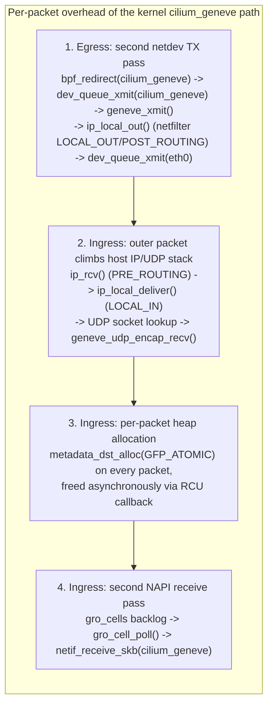
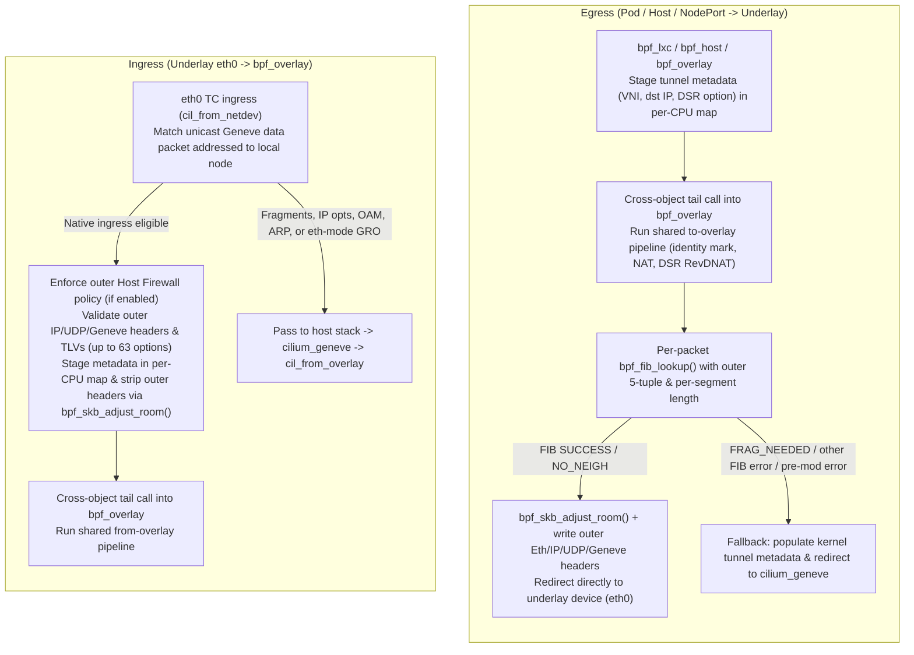

# CFP-XXXXX: Native eBPF Geneve Datapath

**SIG:** SIG-Datapath ([View all current SIGs](https://docs.cilium.io/en/stable/community/community/#all-sigs))

**Begin Design Discussion:** 2026-10-01

**Cilium Release:** 1.21

**Authors:** Kevin Wang <kevixw@gmail.com>

**Status:** Draft

**Related Issue:** https://github.com/cilium/cilium/issues/XXXXX

**Proof Of Concept:** https://github.com/ql-owo-lp/cilium/tree/google-geneve-datapath

## Summary

Allow Cilium to encapsulate and decapsulate Geneve overlay traffic directly in
its TC eBPF programs instead of traversing the kernel `cilium_geneve` virtual
device and host IP/UDP stack on every packet, while keeping `cilium_geneve` as
a lossless fallback for packets the native path does not handle.

## Motivation

In tunnel routing mode with `tunnelProtocol=geneve`, Cilium currently creates a
single kernel `cilium_geneve` device in `collect_md` (external metadata) mode
and attaches `cil_to_overlay` and `cil_from_overlay` (`bpf_overlay.c`) to it.
While `collect_md` avoids creating one netdev per peer, every overlay packet
still pays for traversing the virtual tunnel device and the host network stack:

1. **Egress: a second transmit pass and outer netfilter traversal.** Pod and
   host programs populate tunnel metadata with `bpf_skb_set_tunnel_key()` /
   `bpf_skb_set_tunnel_opt()` and redirect to `cilium_geneve`. The packet runs
   through `dev_queue_xmit()` on `cilium_geneve`, enters the Geneve driver to
   push outer headers, traverses `ip_local_out()` (including netfilter
   `LOCAL_OUT` and `POST_ROUTING` and outer UDP conntrack when loaded), and only
   then reaches `dev_queue_xmit()` on the underlay device (`eth0`).
2. **Ingress: outer IP/UDP stack traversal.** Every incoming Geneve packet is
   processed as a local UDP datagram on the host (`ip_rcv`, netfilter
   `PRE_ROUTING` and `LOCAL_IN`, and UDP socket lookup) before reaching the
   Geneve driver.
3. **Ingress: per-packet heap allocation.** Because a `collect_md` device has no
   fixed tunnel key, `geneve_rx()` allocates a `struct metadata_dst` with
   `kmalloc(..., GFP_ATOMIC)` for every received packet to hold the outer
   header and TLV options, and frees it later through an RCU callback when the
   `sk_buff` is consumed.
4. **Ingress: a second NAPI pass through `gro_cells`.** After decapsulation, the
   Geneve driver queues the packet on the per-CPU `gro_cells` backlog and
   schedules NAPI to inject the packet a second time on `cilium_geneve`, where
   `cil_from_overlay` finally runs.

Meanwhile, `bpf_skb_adjust_room()` and `bpf_fib_lookup()` already allow TC eBPF
programs to push and strip outer Ethernet/IP/UDP/Geneve headers and resolve
underlay next-hops directly on the `sk_buff`, redirecting straight to the
underlay device on egress and straight into the overlay ingress logic on
ingress.

## Goals

* Perform Geneve encapsulation and decapsulation in Cilium's TC eBPF programs
  for pod, host, and NodePort traffic while reusing the existing `bpf_overlay`
  egress and ingress pipelines (policy, NAT, DSR, ClusterMesh, Egress Gateway,
  and Hubble tracing).
* Maintain wire compatibility with `cilium_geneve` in the default `eth` inner
  mode (`bpf.geneve.innerProtocol=eth`), allowing node-by-node rollout and
  rollback in mixed clusters.
* Never drop a packet that the kernel path would deliver: any packet the native
  path cannot handle before modifying the `sk_buff` falls back to
  `cilium_geneve`.
* Zero impact when disabled (the default).
* Support an optional `ip` inner mode (`bpf.geneve.innerProtocol=ip`) that omits
  the 14-byte inner Ethernet header on homogeneous clusters, increasing pod
  route MTU by 14 bytes.

## Non-Goals

* Removing `cilium_geneve`. The kernel device stays configured to handle
  fallback packets, overlay multicast, non-IP inner frames (such as VTEP ARP),
  `eth`-mode GRO aggregates on ingress, and Geneve packets decrypted on
  `cilium_wg0`.
* VXLAN or XDP decapsulation in this proposal (both are natural follow-ups; see
  [Future Milestones](#future-milestones)).
* Changing default behavior (`bpf.geneve.enabled` defaults to `false`).

## Proposal

*This design is accompanied by a
[proof of concept](https://github.com/ql-owo-lp/cilium/tree/google-geneve-datapath)
implementing the native eBPF Geneve datapath and benchmark script.*

### Overview

### Configuration

The feature is controlled by two Helm values (and corresponding `cilium-agent`
flags):

* `bpf.geneve.enabled` (`--enable-bpf-geneve`, default `false`): enables the
  native eBPF Geneve datapath when `routingMode=tunnel` and
  `tunnelProtocol=geneve`.
* `bpf.geneve.innerProtocol` (`--geneve-inner-protocol`, default `eth`):
  * `eth`: encapsulates the inner Ethernet frame (`ETH_P_TEB`, `0x6558`),
    matching `cilium_geneve` on the wire.
  * `ip`: encapsulates the inner IPv4 or IPv6 packet directly (`ETH_P_IP` /
    `ETH_P_IPV6`) without an inner Ethernet header, saving 14 bytes per packet.

At startup, the agent probes the running kernel for the required
`bpf_skb_adjust_room()` flags (`BPF_F_ADJ_ROOM_ENCAP_L2_ETH` on Linux $\ge 5.13$,
and `BPF_F_ADJ_ROOM_DECAP_L3_IPV4/6` on Linux $\ge 6.3$ when pod and underlay IP
families differ) and refuses to start with a clear error if they are unavailable.
In `ip` mode, the agent also probes for `BPF_F_ADJ_ROOM_DECAP_L4_UDP` (`bpf-next`
commits `3a39c214fd2c` and `ec20dee2f2c4`) to clear outer UDP tunnel GSO state on
incoming GRO aggregates when supported.

### Egress Path

1. **Staging metadata and entering the `bpf_overlay` pipeline:** When a TC
   program (`bpf_lxc`, `bpf_host`, or `bpf_overlay`) encapsulates a packet, it
   writes the tunnel VNI, remote endpoint IP, and optional Geneve DSR option into
   a per-CPU metadata map (`cilium_geneve_meta`) and tail-calls into
   `bpf_overlay` via a shared program array (`cilium_calls_bpf_overlay`).
2. **Reusing `to-overlay` logic:** `bpf_overlay` marks the packet with
   `MARK_MAGIC_OVERLAY` and the source identity, and runs the existing overlay
   egress NAT, ClusterMesh, and DSR reverse-DNAT logic. Bandwidth Manager (EDT)
   departure scheduling is deferred to `cil_to_netdev` on the physical underlay
   device so that `skb->tstamp` and `queue_mapping` are not cleared across the
   redirect from the pod veth.
3. **Per-packet FIB lookup and header push:** At the end of the `to-overlay`
   pipeline, `bpf_overlay` computes the outer UDP source port (using the same
   hash formula and `--tunnel-source-port-range` as the kernel's
   `udp_flow_src_port()`), calculates the encapsulated wire length of a single
   segment, and calls `bpf_fib_lookup()`. On `SUCCESS` or `NO_NEIGH`, it grows
   the packet headroom with `bpf_skb_adjust_room()`, writes the outer Ethernet,
   IPv4/IPv6, UDP, and Geneve headers (plus any staged TLV options), and
   redirects directly to the underlay interface via `bpf_redirect()` or
   `bpf_redirect_neigh()`.

### Ingress Path

1. **Intercept on the underlay device:** On TC ingress of the underlay device
   (`cil_from_netdev` in `bpf_host`), after emitting `TRACE_FROM_NETWORK` for
   the outer packet, Cilium checks whether the frame is a unicast IPv4/IPv6 UDP
   packet to `tunnel-port` addressed to a local node IP, with a version-0
   non-OAM Geneve header carrying an enabled inner IP family (`ETH_P_TEB` with
   inner IPv4/IPv6, or direct `ETH_P_IP` / `ETH_P_IPV6`).
2. **Host Firewall and header validation:** Matching packets tail-call the
   Geneve decapsulation handler, which first runs the ingress Host Firewall
   policy on the outer packet (when enabled), validates the outer IP, UDP, and
   Geneve headers and up to 63 TLV options (rejecting unknown critical options
   per RFC 8926 §3.5), and saves the VNI, outer addresses, and TLV options in
   the per-CPU metadata map.
3. **Header strip and hand-off to `bpf_overlay`:** The handler strips the outer
   headers with `bpf_skb_adjust_room()`, applies RFC 6040 ECN decapsulation,
   decrements `csum_level` so outer UDP checksum offload is not mistaken for
   inner L4 verification, resets `queue_mapping`, pops any VID-0 priority tag,
   and tail-calls into `bpf_overlay` via `cilium_calls_bpf_overlay` to run the
   existing `from-overlay` pipeline.

### Kernel-Device Fallback

`cilium_geneve` remains configured with `cil_from_overlay` and `cil_to_overlay`
attached and handles every packet the native path declines:

* **Ingress pass-through:** Outer IP fragments, packets with IPv4 options or
  IPv6 extension headers, Geneve OAM control frames, non-IP inner payloads (such
  as VTEP ARP), frames not addressed to the host, packets decrypted on
  `cilium_wg0`, and `eth`-mode GRO aggregates are passed to the host stack and
  decapsulated by `cilium_geneve` as today.
* **Egress fallback:** If `bpf_fib_lookup()` returns `FRAG_NEEDED` (for example,
  when a packet exceeds the underlay route MTU or a learned PMTU exception) or
  any status other than `SUCCESS` / `NO_NEIGH`, if no outer source IP is
  available, or if `bpf_skb_adjust_room()` fails before modifying the packet,
  the egress handler populates the kernel tunnel metadata via
  `bpf_skb_set_tunnel_key()` / `bpf_skb_set_tunnel_opt()`, sets a fallback
  marker in `tc_index` so `cil_to_overlay` does not re-run the `to-overlay`
  pipeline a second time, and redirects the unmodified packet to
  `cilium_geneve`.

### Wire Format and MTU

In `eth` mode, the native path matches the wire format of `cilium_geneve`:

| Field | Kernel `cilium_geneve` | Native BPF (`eth` mode) | Native BPF (`ip` mode) |
| --- | --- | --- | --- |
| Geneve `protocol_type` & inner L2 | `ETH_P_TEB` (`0x6558`) + 14B Ethernet header | `ETH_P_TEB` (`0x6558`) + 14B Ethernet header | `ETH_P_IP` (`0x0800`) or `ETH_P_IPV6` (`0x86DD`), no inner Ethernet header |
| Pod route MTU (on 1500B underlay) | `1450B` (IPv4) / `1430B` (IPv6) | `1450B` (IPv4) / `1430B` (IPv6) | `1464B` (IPv4) / `1444B` (IPv6) |
| Outer IPv4 `DF` bit | `0` | `0` (oversized packets fall back to `cilium_geneve` for fragmentation) | `1` (`IP_DF`; path MTU between nodes must be $\ge$ underlay device MTU) |
| Outer UDP source port | `udp_flow_src_port()` over `skb_get_hash()` | Same formula over `get_hash_recalc()` within `--tunnel-source-port-range` | Same |
| Outer TTL / ECN | TTL `64`, DSCP `0`, RFC 6040 ECN encap/decap | Same | Same |
| Outer UDP checksum | `0` (IPv4), non-zero (IPv6) | `0` (IPv4 and IPv6, per RFC 8926 §3.3 / RFC 6935) | `0` (IPv4 and IPv6) |
| Critical TLV validation (RFC 8926 §3.5) | Accepts unknown critical TLVs | Drops unknown critical TLVs (`DROP_GENEVE_OPT_INVALID`) | Drops unknown critical TLVs (`DROP_GENEVE_OPT_INVALID`) |

### Interactions with Other Features and Observability

* **WireGuard & IPsec:** Egress overlay packets retain `MARK_MAGIC_OVERLAY` when
  redirected to the underlay device, so `cil_to_netdev` redirects them into
  `cilium_wg0` or XFRM encryption exactly as on the kernel path. On ingress,
  IPsec-decrypted packets recirculate through `cil_from_netdev` and are
  decapsulated natively, while WireGuard-decrypted packets on `cilium_wg0` are
  decapsulated by `cilium_geneve`.
* **L7 Proxy, Legacy Host Routing, and `rp_filter`:** Natively decapsulated
  packets that are passed to the host stack enter on the underlay device rather
  than `cilium_geneve`. Because the return route for pod IPs points to
  `cilium_host`, strict reverse-path filtering (`rp_filter=1`) on the underlay
  device would reject them; the agent therefore relaxes `rp_filter` from `1`
  (strict) to `2` (loose) on native devices when `bpf.geneve.enabled=true`
  (leaving `0` and `2` unchanged, following the existing ENI routing precedent).
* **Observability:** Native egress and ingress emit the same `TRACE_TO_OVERLAY`
  and `TRACE_FROM_OVERLAY` Hubble events (reporting `cilium_geneve`'s ifindex)
  as the kernel path, add three drop reasons (`DROP_GENEVE_HDR_INVALID`,
  `DROP_GENEVE_OPT_INVALID`, `DROP_GENEVE_ENCAP_FAILED`), and register the new
  BPF maps in `cilium-bugtool`.

### Performance Evaluation

[`contrib/scripts/benchmark-geneve-bpf.sh`](https://github.com/ql-owo-lp/cilium/blob/google-geneve-datapath/contrib/scripts/benchmark-geneve-bpf.sh)
is a cluster-agnostic benchmark script included in the PoC branch that compares
**Kernel Geneve (Baseline)** (`enable-bpf-geneve=false`), **BPF Geneve (`eth`)**
(`enable-bpf-geneve=true`, `geneve-inner-protocol=eth`), and **BPF Geneve
(`ip`)** (`enable-bpf-geneve=true`, `geneve-inner-protocol=ip`) on any
multi-node Kubernetes cluster. Modes are switched strictly by patching
`cilium-config` against the same Cilium image and rotating mode order across
iterations (`n = 5` iterations, `5 s` per `iperf3` run).

#### Testbed (4-Node Cluster on GCE VMs)

* **Nodes:** 4 $\times$ GCE `n2-standard-4` VMs in `us-central1-a` (1
  control-plane + 3 workers), 4 vCPUs and 16 GiB RAM per VM, Intel Xeon @
  2.80 GHz, Ubuntu 22.04.1 LTS, Linux `6.8.0-138-generic`.
* **Network:** GCE VPC IPv4 underlay, `ens4` (`virtio_net`, 4 TX / 4 RX queues),
  MTU `1460` (pod route MTU `1410` in Kernel and `eth` modes, `1424` in `ip`
  mode), 10 Gbit/s per-VM egress cap.
* **Cilium config:** `routing-mode=tunnel`, `tunnel-protocol=geneve`,
  `kube-proxy-replacement=true`, `enable-ipv4=true`. Cross-node client pod on
  `worker-0`, server and same-node client pods on `worker-1`, `NodePort`
  forwarder on `worker-2`.

#### Results — 4-Node GCE VMs (`n = 5` Iterations, Mean $\pm$ Sample SD)

| Workload / metric | Unit | Better | Kernel Geneve (Baseline) | BPF Geneve (`eth`) | BPF Geneve (`ip`) | BPF Geneve (`eth`) vs Kernel | BPF Geneve (`ip`) vs Kernel | BPF Geneve (`ip`) vs BPF Geneve (`eth`) |
| --- | --- | --- | --- | --- | --- | --- | --- | --- |
| TCP (same node, no tunnel), 4 streams | Gbit/s | higher | `52.83 ± 4.18` | `53.41 ± 4.86` | `52.60 ± 2.43` | `+1.1 %` | `-0.4 %` | `-1.5 %` |
| TCP, 1 stream | Gbit/s | higher | `6.17 ± 0.39` | `6.28 ± 0.60` | `6.60 ± 0.47` | `+1.9 %` | `+7.1 %` | `+5.1 %` |
| TCP, 4 streams | Gbit/s | higher | `8.70 ± 0.08` | `7.84 ± 1.03` | `8.71 ± 0.21` | `-9.9 %` | `+0.2 %` | `+11.1 %` |
| TCP, 8 streams | Gbit/s | higher | `8.79 ± 0.03` | `8.31 ± 1.12` | `8.89 ± 0.06` | `-5.5 %` | `+1.1 %` | `+7.0 %` |
| TCP, 8 streams: combined node `softirq` CPU (client+server) | % of one CPU | lower | `202.5 ± 3.9` | `152.8 ± 24.5` | `152.9 ± 7.6` | `-24.5 %` | `-24.5 %` | `+0.1 %` |
| TCP, 8 streams: throughput per `softirq` CPU | Gbit/s per CPU | higher | `4.34 ± 0.09` | `5.46 ± 0.32` | `5.82 ± 0.25` | `+25.8 %` | `+34.1 %` | `+6.6 %` |
| TCP, bidirectional, 4 streams (sum) | Gbit/s | higher | `15.34 ± 0.68` | `14.27 ± 1.18` | `15.43 ± 1.00` | `-7.0 %` | `+0.6 %` | `+8.2 %` |
| TCP, 128-byte writes, `TCP_NODELAY`, 4 streams | Gbit/s | higher | `1.761 ± 0.056` | `1.780 ± 0.089` | `1.902 ± 0.054` | `+1.1 %` | `+8.0 %` | `+6.9 %` |
| TCP via `ClusterIP` service, 4 streams | Gbit/s | higher | `8.35 ± 0.80` | `8.78 ± 0.04` | `8.83 ± 0.08` | `+5.1 %` | `+5.7 %` | `+0.6 %` |
| TCP via `NodePort` of another node, 4 streams | Gbit/s | higher | `6.91 ± 1.89` | `7.97 ± 1.11` | `7.32 ± 2.08` | `+15.2 %` | `+5.8 %` | `-8.2 %` |
| TCP at fixed `4 x 2.5 Gbit/s`: combined node `softirq` CPU | % of one CPU | lower | `186.9 ± 12.6` | `138.2 ± 23.6` | `151.5 ± 9.8` | `-26.1 %` | `-18.9 %` | `+9.6 %` |
| UDP 64 B at fixed `4 x 6.4 Mbit/s` (50 kpps): combined `softirq` CPU | % of one CPU | lower | `68.1 ± 49.7` | `63.1 ± 24.3` | `34.1 ± 22.0` | `-7.4 %` | `-50.0 %` | `-46.0 %` |
| UDP 64 B, unlimited, 4 streams: received | kpps | higher | `243.1 ± 70.4` | `432.6 ± 95.1` | `330.3 ± 145.3` | `+78.0 %` | `+35.9 %` | `-23.6 %` |
| UDP 64 B, unlimited, 4 streams: `iperf3` CPU per received datagram | µs | lower | `22.394 ± 6.325` | `13.830 ± 2.457` | `16.793 ± 6.671` | `-38.2 %` | `-25.0 %` | `+21.4 %` |
| UDP 512 B, unlimited, 4 streams: received | Gbit/s | higher | `1.09 ± 0.29` | `1.47 ± 0.43` | `1.81 ± 0.43` | `+35.6 %` | `+66.8 %` | `+23.0 %` |
| UDP 1380 B, unlimited, 4 streams: received | Gbit/s | higher | `2.52 ± 0.61` | `3.69 ± 1.44` | `4.38 ± 0.58` | `+46.4 %` | `+73.5 %` | `+18.5 %` |
| ICMP echo, 56-byte payload: mean / p99 RTT | ms | lower | `0.110` / `0.179` | `0.107` / `0.182` | `0.095` / `0.152` | `-3.3 %` / `+1.4 %` | `-14.0 %` / `-15.2 %` | `-11.1 %` / `-16.4 %` |
| ICMP echo, 1360-byte payload: mean / p99 RTT | ms | lower | `0.120` / `0.197` | `0.106` / `0.179` | `0.100` / `0.159` | `-11.4 %` / `-9.1 %` | `-16.5 %` / `-19.1 %` | `-5.7 %` / `-10.9 %` |

#### Discussion of Benchmark Results

1. **10 Gbit/s VM NIC cap on bulk TCP (`softirq` CPU savings vs. line-rate ceiling):**
   On 4-vCPU GCE VMs, the hypervisor enforces a 10 Gbit/s underlay egress cap,
   so multi-stream inner TCP goodput saturates around `8.75–8.90 Gbit/s` in all
   three modes (`8.79 Gbit/s` in Kernel Geneve vs. `8.89 Gbit/s` in BPF Geneve
   `ip`, where omitting the 14B inner Ethernet header yields `+1.0%` higher wire
   efficiency). Because bulk TCP throughput is pinned at the NIC cap, the
   datapath savings show up in **combined node `softirq` CPU**, which drops by
   **`-24.5%`** in both **BPF Geneve (`eth`)** and **BPF Geneve (`ip`)**
   (`152.8%` and `152.9%` vs. `202.5%` in Kernel Geneve), yielding **`+25.8%`
   (`eth`) and `+34.1%` (`ip`) more Gbit/s per `softirq` CPU**.
2. **Short-window (`5 s`) hypervisor policer variance in `eth`-mode bulk TCP:**
   In **BPF Geneve (`eth`)**, 4 of 5 iterations of 8-stream TCP achieved `8.81 ±
   0.06 Gbit/s` (matching the NIC cap), while one iteration (`6.31 Gbit/s`) hit
   a hypervisor token-bucket tail drop during initial slow-start that lowered the
   5-second mean (`8.31 ± 1.12 Gbit/s`).
3. **`eth`-mode GRO ingress vs. `ip`-mode native ingress:**
   On released kernels (`Linux 6.8`), **BPF Geneve (`eth`)** leaves GRO-merged
   incoming TCP aggregates to `cilium_geneve` on ingress, whereas non-GRO
   workloads (`TCP_NODELAY`, UDP, ICMP) and **BPF Geneve (`ip`)** use the native
   path on both egress and ingress.
4. **Packet-rate (UDP) and latency (ICMP) gains:**
   For workloads not bottlenecked by the 10 Gbit/s hypervisor cap or GRO,
   bypassing `cilium_geneve`, `metadata_dst` allocation, and `gro_cells` backlog
   queuing improves unlimited 64B UDP packet rate by **`+78.0%` (`eth`)** and
   **`+35.9%` (`ip`)**, 512B UDP throughput by **`+35.6%` (`eth`)** and
   **`+66.8%` (`ip`)**, 1380B UDP throughput by **`+46.4%` (`eth`)** and
   **`+73.5%` (`ip`)**, and 1360B ICMP mean RTT by **`-11.4%` (`eth`)** and
   **`-16.5%` (`ip`)**.

## Impacts / Key Questions

### Key Question: How should the native path reuse the `bpf_overlay` pipelines?

`cil_to_overlay` and `cil_from_overlay` contain overlay logic that must run on
every packet regardless of whether outer headers are handled by the kernel or by
eBPF (VNI-to-identity mapping, `MARK_MAGIC_OVERLAY`, ClusterMesh and NodePort
SNAT, Geneve DSR option handling, Egress Gateway, overlay policy, and Hubble
tracing).

#### Option 1: Duplicate the overlay logic inside `bpf_lxc` and `bpf_host`

##### Pros
* No cross-object tail calls or loader changes.

##### Cons
* High maintenance burden; any change to `bpf_overlay` must be kept in sync
  across multiple objects and increases verifier complexity in `bpf_lxc` and
  `bpf_host`.

#### Option 2: Encapsulate in `cil_to_overlay` on `cilium_geneve` and redirect to the underlay

##### Pros
* Avoids cross-object tail calls on egress.

##### Cons
* Egress still pays for a `dev_queue_xmit()` pass through `cilium_geneve`.
* Does not work for ingress: re-injecting into `cilium_geneve` ingress still
  incurs a backlog pass and would trigger `cil_from_overlay` a second time.

#### Option 3: Tail-call across objects into a shared program array owned by `bpf_overlay.o`

`bpf_overlay.o` exports a pinned `BPF_MAP_TYPE_PROG_ARRAY`
(`cilium_calls_bpf_overlay`) with entry points for the `from-overlay` and
`to-overlay` pipelines, and a 2-entry per-CPU array (`cilium_geneve_meta`) used
to pass the tunnel metadata across the tail call.

##### Pros
* Works for both egress and ingress with a single tail call and zero code
  duplication.
* Eliminates the `cilium_geneve` device pass in both directions.

##### Cons
* Requires small loader extensions so Cilium's collection loader can populate
  and retain tail-call maps beyond the per-object `cilium_calls` array.

#### Preference: Option 3

Sharing `bpf_overlay`'s pipelines via a pinned program array keeps a single
source of truth for overlay processing while avoiding `cilium_geneve` traversal
on both egress and ingress.

---

### Key Question: Should the outer route be cached in BPF?

Neither the kernel `cilium_geneve` path nor the proposed native path caches the
outer route. On the kernel path, `bpf_skb_set_tunnel_key()` always sets
`IP_TUNNEL_NOCACHE_BIT` on the shared per-CPU `md_dst` (and `cil_to_overlay`
sets `skb->mark`), so `ip_tunnel_dst_cache_usable()` always returns `false` and
the Geneve driver performs a fresh route lookup on every packet.

#### Option 1: Cache outer routes/MACs in a BPF LRU map keyed by remote node IP

##### Pros
* Saves a `bpf_fib_lookup()` call per packet.

##### Cons
* Ignores the outer L4 source port hash, breaking ECMP multipath distribution.
* Risks blackholing traffic until TTL expiry when underlay routes or neighbor
  MACs change.
* Adds pinned maps and downgrade cleanup complexity.

#### Option 2: Call `bpf_fib_lookup()` per packet with the outer UDP 5-tuple

##### Pros
* Matches the kernel's per-packet ECMP hashing over the outer 5-tuple.
* Picks up route, neighbor, and PMTU changes immediately on the next packet.
* Checks the route MTU against each packet's (or GSO segment's) encapsulated
  length.

##### Cons
* Runs `bpf_fib_lookup()` once per packet (same as native routing mode and the
  kernel Geneve path).
* Without `BPF_FIB_LOOKUP_MARK` (Linux $\ge 6.10$), `bpf_fib_lookup()` does not
  pass `skb->mark`, so custom user `ip rule fwmark` rules matching the overlay
  mark are not evaluated.

#### Preference: Option 2

Per-packet `bpf_fib_lookup()` matches Cilium's existing native-routing path and
preserves ECMP hashing and immediate route/PMTU convergence.

---

### Key Question: What should happen to packets the native path cannot encapsulate?

On the kernel path, `cilium_geneve` leaves the outer IPv4 `DF` bit unset, so
packets that exceed the underlay route MTU are fragmented by `ip_fragment()`
rather than dropped.

#### Option 1: Drop with a Cilium drop reason or send ICMP Frag Needed

##### Pros
* Simpler egress path; no fallback into `cilium_geneve`.

##### Cons
* Breaks compatibility with workloads that rely on outer IPv4 fragmentation when
  pod packets exceed a reduced path MTU.

#### Option 2: Hand the unmodified packet to `cilium_geneve`

Before modifying the packet, if `bpf_fib_lookup()` returns `FRAG_NEEDED` or any
error other than `SUCCESS` / `NO_NEIGH`, the native path populates the kernel
tunnel key/options and redirects the packet to `cilium_geneve`.

##### Pros
* Preserves exact kernel behavior for oversized packets and edge cases: enabling
  `bpf.geneve.enabled` never drops a packet that `cilium_geneve` would deliver.

##### Cons
* Requires keeping `cilium_geneve` configured and setting a `tc_index` marker to
  skip re-running `handle_to_overlay()`.

#### Preference: Option 2

Falling back to `cilium_geneve` makes `eth` mode a drop-in optimization that
cannot introduce MTU or routing regressions.

---

### Key Question: Why do `eth`-mode GRO aggregates stay on `cilium_geneve` on ingress, and should `ip` mode be included now?

When hardware or driver GRO on the underlay merges incoming Geneve TCP segments
before TC ingress, the kernel sets `skb->encapsulation` and
`SKB_GSO_UDP_TUNNEL`. On released kernels, shrinking such an aggregate with
`bpf_skb_adjust_room()` does not clear those flags, which breaks subsequent
re-segmentation. Upstream `bpf-next` commits `3a39c214fd2c` and `ec20dee2f2c4`
add `BPF_F_ADJ_ROOM_DECAP_L4_UDP` to clear the outer UDP tunnel GSO state.

* In **`eth` mode**, leaving GRO aggregates (`ctx_gso_size(ctx) > 0`) to
  `cilium_geneve` works on all kernels $\ge 5.13$ without needing
  `BPF_F_ADJ_ROOM_DECAP_L4_UDP`.
* In **`ip` mode**, `cilium_geneve` cannot be used as a fallback for GRO
  aggregates because the kernel `geneve` driver drops non-`ETH_P_TEB` frames.
  `ip` mode also requires all nodes in the cluster to use `ip` mode and a path
  MTU at least equal to the underlay device MTU (since the kernel ignores ICMP
  PMTU errors for non-`ETH_P_TEB` Geneve packets).

**Open question for reviewers:** Should we include `ip` mode (`bpf.geneve.innerProtocol=ip`)
in the initial PR series gated by the startup probe for `BPF_F_ADJ_ROOM_DECAP_L4_UDP`,
or land `eth` mode first and add `ip` mode in a follow-up PR?

---

### Impact: Netfilter and Host Stack Entry Interface

* **Netfilter bypass for outer packets:** On the native path, outer UDP Geneve
  packets no longer traverse host netfilter (`LOCAL_OUT`/`POST_ROUTING` on
  egress, `PRE_ROUTING`/`LOCAL_IN` on ingress) or create outer UDP conntrack
  entries. Inner packet netfilter hooks are unchanged, and Cilium's Host
  Firewall continues to evaluate the outer packet before decapsulation.
* **Host stack ingress interface:** Natively decapsulated packets that pass up
  to the local host stack (such as L7 proxy traffic, legacy host routing, or DSR
  without BPF host routing) arrive on the underlay device rather than
  `cilium_geneve`.

## Future Milestones

* **Native decapsulation of GRO aggregates in `eth` mode:** Once
  `BPF_F_ADJ_ROOM_DECAP_L4_UDP` reaches released kernels, use the startup probe
  to enable native decapsulation of GRO aggregates in `eth` mode as well.
* **XDP decapsulation and NodePort acceleration:** Reuse the Geneve header and
  TLV parser in `bpf_xdp.c` (via `bpf_xdp_adjust_head()`) for early XDP
  decapsulation and DSR forwarding.
* **Policy-routing mark in `bpf_fib_lookup()`:** Use `BPF_FIB_LOOKUP_MARK` on
  Linux $\ge 6.10$ to pass `skb->mark` into the outer FIB lookup.
* **VXLAN support:** Apply the same shared `cilium_calls_bpf_overlay` tail-call
  and `cilium_vxlan` fallback architecture to VXLAN.
* **Graduation from beta to default:** Evaluate enabling `bpf.geneve.enabled` by
  default when `tunnelProtocol=geneve` after field validation across kernel
  versions, NIC drivers, and encryption modes.
