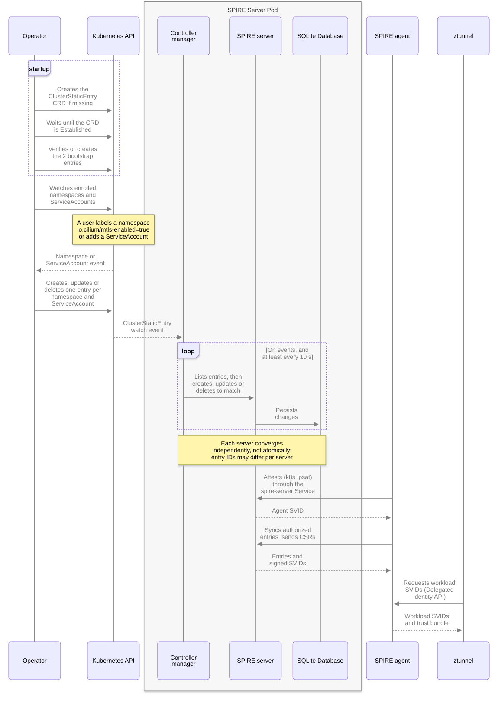
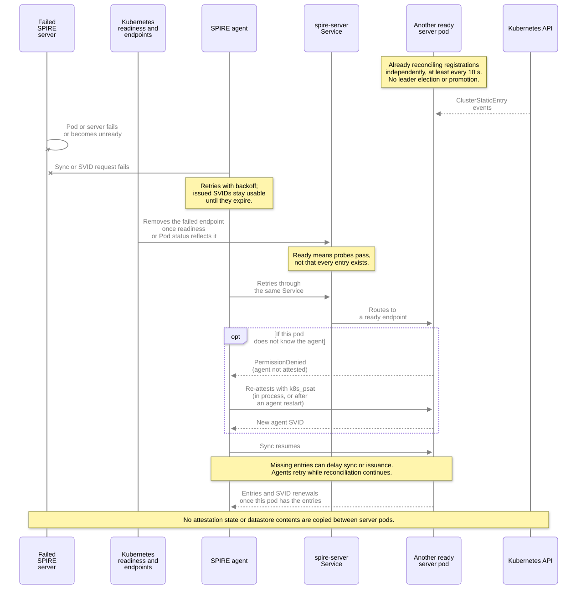

# HA SPIRE Registrations via SPIRE Controller Manager

**SIG: SIG-ServiceMesh**

**Begin Design Discussion:** 11/24/2026

**Cilium Release:** 1.21

**Authors:** Ethan Ermovick <eermovick@microsoft.com>, Tamilmani Manoharan <tamanoha@microsoft.com>

**Status:** Draft

## Summary

Cilium's new mTLS feature combines ztunnel with SPIRE to issue workload certificates and encrypt traffic. However, a single-replica SPIRE server creates a single point of failure for certificate issuance and renewal. If the spire server goes down, new workloads cannot obtain certificates, while existing workloads lose mTLS connectivity once their certificates expire. This proposal gives a solution to make the spire server HA and avoid disruption even if one spire server goes down.


## Motivation

Currently, the SPIRE Server runs as a single replica, and the Cilium Operator calls the SPIRE Entry API directly to upsert workload registrations into its database. A server outage prevents new workloads from registering and obtaining certificates, and existing workloads from renewing theirs. Adding replicas alone is not sufficient: registration state must remain consistent across replicas so that surviving instances can continue issuing and renewing certificates when another replica fails. Each replica maintains its own database, with no mechanism to synchronize state across replicas.

## Goals

* Make the Spire server Highly Available. A single replica going down should not disrupt certificate issuance.
* Allow failover to a working SPIRE server if one fails.
* Ensure new spire servers continue to serve requests for new or existing workloads.
* Ensure workloads trust each other's certificates even when those certificates are issued by different SPIRE server pods

## Non-Goals

* Replicating SPIRE agent attestations between servers. An agent that moves to another server re-attests
* Upgrade from non HA mode to HA mode with uninterrupted traffic
* Downgrade from HA mode to non HA mode

## Proposal

This proposal introduces high availability for SPIRE Server through multiple replicas, allowing SPIRE agents to continue accessing the spire service when a replica fails. It leverages OSS project[`spire-controller-manager`][spire-controller-manager] to manage SPIFFE registrations through Kubernetes custom resources and reconcile them into the SPIRE Server. Multiple instances of the `spire-controller-manager`, SPIRE server, and datastore can be run for redundancy. Each SPIRE server keeps its own datastore and runs its own controller, which reconciles the same resources into that server only. This reconstructs registrations independently on each server rather than replicating databases. 

### Overview


The following diagram shows the components with the feature enabled and the default two SPIRE server and controller pairs.



Currently, the Cilium Operator manages SPIRE registration entries directly through the SPIRE Entry API. With this feature enabled, the Operator will instead manage `ClusterStaticEntry` custom resources from spire-controller-manager, and no longer interact with the SPIRE Entry API. A `ClusterStaticEntry` defines SPIRE entry registration intent, and the Operator ensures one for every ServiceAccount in an mtls enrolled namespace. In each SPIRE server pod, a `spire-controller-manager` sidecar watches these resources and reconciles them through the SPIRE Entry API into a local SQLite datastore for that SPIRE server pod. It updates its datastore on resource events and at least every 10 seconds. Additionally, at each elected-leader startup, the Cilium Operator creates the `ClusterStaticEntry` CRD if it is missing and creates two ClusterStaticEntry resources (the SPIRE agent node alias and the ztunnel identity, described under Bootstrap ClusterStaticEntries). This removes the need for `cilium-init` in SPIRE HA mode. Multiple SPIRE server pods then independently reconcile the `ClusterStaticEntry`s (which define both the user and bootstrap SPIRE entries) into equivalent registration entries, providing redundancy. Every server's CA chains to one shared upstream root, so that SPIRE agents attested to different SPIRE servers trust each other. SPIRE agents connect to a SPIRE server through the `spire-server` Service, which uses `ClientIP` session affinity when more than one server runs, so that SPIRE agents favor the server they are already using. Nothing copies datastore contents or agent attestations between servers. With multiple SPIRE server pods, if one fails, a SPIRE agent can then failover and reattest to a different working server.

### Prerequisite Helm Flags

The following existing Helm settings are required to enable this feature: 

* `encryption.enabled=true`
* `encryption.type=ztunnel`
* `encryption.ztunnel.ca.type=spire`
* `authentication.mutual.spire.enabled=true`
* `authentication.mutual.spire.install.enabled=true`
* `operator.enabled=true`

### New Helm Fields

This feature is gated behind the Helm value authentication.mutual.spire.ha.enabled=true (default false). When set to false, the old datapath is used, and no ClusterStaticEntries are created. The following Helm fields are added in this proposal. 

* `authentication.mutual.spire.ha.enabled=true`
* `authentication.mutual.spire.ha.replicas=n` defines the number of spire server replicas

This new dataflow is off by default. With the HA setting enabled, Helm deploys the `spire-controller-manager` sidecar; the operator installs or verifies the `ClusterStaticEntry` CRD and creates the `ClusterStaticEntry` resources that store registration intent.

### New Operator Flag

`--mesh-auth-spire-ha-enabled` is a boolean flag added to the Operator that enables HA mode only when set to `true`.

### Changes from Old Datapath

With the feature enabled, the Cilium Operator no longer directly makes SPIRE Entry API calls, instead managing `ClusterStaticEntry`s. `cilium-init` also no longer exists, and bootstrap entries are instead created by fixed `ClusterStaticEntry` resources created at Cilium Operator elected-leader startup.

### SPIRE Controller Manager Reconciliation

The [SPIRE Controller Manager][spire-controller-manager] project provides multiple custom resources that can define registration intent. We specifically only enable `ClusterStaticEntry` reconciliation, and ignore `ClusterSPIFFEIDs` and `ClusterFederatedTrustDomains`, using the settings below.

```yaml
reconcile:
  clusterStaticEntries: true
  clusterSPIFFEIDs: false
  clusterFederatedTrustDomains: false
```

### One ClusterStaticEntry per service account in an enrolled namespace

For each service account in an enrolled namespace, the backend creates one cluster-scoped `ClusterStaticEntry` custom resource. For example, for the `backend` ServiceAccount in an enrolled `payments` namespace, the operator would generate this resource:

```yaml
apiVersion: spire.spiffe.io/v1alpha1
kind: ClusterStaticEntry
metadata:
  name: ztunnel-payments.backend
  labels:
    app.kubernetes.io/managed-by: cilium-operator-ztunnel
    spire.cilium.io/namespace: payments
  annotations:
    spire.cilium.io/service-account: payments/backend
spec:
  spiffeID: spiffe://spiffe.cilium/ns/payments/sa/backend
  parentID: spiffe://spiffe.cilium/ns/cilium-spire/sa/spire-agent
  selectors:
    - k8s:ns:payments
    - k8s:sa:backend
```

These are literal values, not templates. The resource is cluster-scoped, so there is no `metadata.namespace`. The two selectors match Pods using `payments/backend`. The registration also exists when that ServiceAccount has no running Pods.

Design points:

* **One CR per service account:** matches workloads by namespace and service account using the `k8s:ns:<namespace>` and `k8s:sa:<service-account>` selectors, with the explicit SPIFFE ID `spiffe://<trust-domain>/ns/<namespace>/sa/<service-account>`
* **Parent ID:** derived from the validated SPIRE agent bootstrap alias, `spiffe://<trust-domain>/ns/<spire-namespace>/sa/<agent-service-account>`, as in the example. The bootstrap resources below declare it on every server. The existing Entry API client keeps its `spiffe://<trust-domain>/ztunnel` parent
* **Only owned fields are updated:** [`Upsert`][upsert] only mutates the fields the operator owns (`spec.spiffeID`, `spec.parentID`, `spec.selectors`, and the namespace label), and leaves all other fields unchanged
* **Ownership label:** the operator sets `app.kubernetes.io/managed-by: cilium-operator-ztunnel` on every `ClusterStaticEntry` it creates, along with a `spire.cilium.io/namespace` label and a `spire.cilium.io/service-account` annotation. It only updates or deletes CRs that carry the ownership label, so CRs owned by anything else are not modified
* **No Pod enumeration:** the registration path watches Namespaces and ServiceAccounts only. Desired entries follow those objects, so creating, deleting, or replacing Pods does not change them, and each server holds one entry per enrolled namespace/ServiceAccount pair


### Bootstrap ClusterStaticEntries

The elected operator ensures two fixed `ClusterStaticEntry` resources, from specifications that Helm passes to it, before it writes any workload resource. They replace the imperative `cilium-init` registrations, so every server, including a new server or one that lost its datastore, receives them from its controller. The operator labels them `app.kubernetes.io/managed-by: cilium-operator-spire-bootstrap`, so workload pruning never deletes them. The examples below use the chart defaults.

**SPIRE agent node alias:** every attested SPIRE agent of the installation matches this entry and receives the entries parented to it, including every workload entry.

```yaml
apiVersion: spire.spiffe.io/v1alpha1
kind: ClusterStaticEntry
metadata:
  name: spire-bootstrap-agent
  labels:
    app.kubernetes.io/managed-by: cilium-operator-spire-bootstrap
spec:
  spiffeID: spiffe://spiffe.cilium/ns/cilium-spire/sa/spire-agent
  parentID: spiffe://spiffe.cilium/spire/server
  selectors:
    - k8s_psat:cluster:default
    - k8s_psat:agent_ns:cilium-spire
    - k8s_psat:agent_sa:spire-agent
```

**ztunnel:** the SPIRE agents authorize this identity as a delegate, so ztunnel can request workload certificates through the Delegated Identity API.

```yaml
apiVersion: spire.spiffe.io/v1alpha1
kind: ClusterStaticEntry
metadata:
  name: spire-bootstrap-ztunnel
  labels:
    app.kubernetes.io/managed-by: cilium-operator-spire-bootstrap
spec:
  spiffeID: spiffe://spiffe.cilium/ztunnel
  parentID: spiffe://spiffe.cilium/ns/cilium-spire/sa/spire-agent
  selectors:
    - k8s:ns:kube-system
    - k8s:sa:ztunnel-cilium
```

### Use Existing Interface for the SPIRE Client in the Operator

The Operator's SPIRE client currently implements the interface below for managing SPIRE entries. In this CFP we continue to use the same interface in the operator client, however the functions now interact with `ClusterStaticEntry`s rather than directly with the SPIRE API.
```go
type SpireClient interface {
	Upsert(context.Context, string) error
	UpsertBatch(context.Context, []string) error
	Delete(context.Context, string) error
	DeleteBatch(context.Context, []string) error
	Initialized() <-chan struct{}
}
```
We additionally implement the `ServiceAccountPruner` interface, which regularly runs to clean up any stale `ClusterStaticEntry`s. This runs every 10 seconds to ensure that even if the operator is down when a namespace is unenrolled, or a ServiceAccount deleted, the `ClusterStaticEntry`s will still be cleaned up.

```go
type ServiceAccountPruner interface {
	Prune(ctx context.Context, namespace string, keep func(id string) bool) error
}
```

### Unenrollment cleanup

When a namespace is unenrolled from SPIRE, the reconciler's [`Delete`][reconciler-delete] calls [`CRDClient.Prune`][crd-prune] for that namespace. `Prune` lists the operator-owned custom resources in the unenrolled namespace and deletes the ones that are no longer desired. The operator reconciler also runs [`Prune`][reconciler-prune] every 10 seconds across all namespaces to clean up stale `ClusterStaticEntry`s, in addition to processing namespace and ServiceAccount events. Deleting an individual service account removes its associated `ClusterStaticEntry`. The SPIRE Controller Manager pods then independently reconcile these deletions into their own SPIRE datastores. The operator's periodic cleanup sweep is separate from SCM's per-server reconciliation; its interval is not a 10-second end-to-end deletion guarantee.

### Multiple SPIRE servers

`authentication.mutual.spire.ha.replicas` sets the number of independent SPIRE server and controller pairs, not database replicas, and defaults to two when `authentication.mutual.spire.ha.enabled=true`. By default the servers are scheduled on different nodes using required Pod anti-affinity on `kubernetes.io/hostname`, unless `authentication.mutual.spire.install.server.affinity` overrides it. When the feature is enabled with more than one server or with disposable storage (`authentication.mutual.spire.install.server.dataStorage.enabled=false`), every server uses an existing shared root CA Secret: `spire-upstream-ca` unless `authentication.mutual.spire.install.server.ca.upstreamSecret` names another. By default, each server gets its own persistent volume and SQLite datastore. Datastore contents are never copied between servers.

Every server uses the disk `UpstreamAuthority` with the same existing root Secret, so their certificates chain to one trust anchor. The chart mounts that Secret but never generates, reads, rotates, or deletes it, and it rejects an upgrade that would change the upstream root automatically.

The `spire-server` Service uses `ClientIP` session affinity when more than one server runs, so each agent keeps using one server. When a server fails or becomes unready, Kubernetes removes it from the Service endpoints after failure detection and routing propagation, and agents reconnect to a remaining server. Attested-node records are not replicated, so an agent re-attests with its projected ServiceAccount token (`k8s_psat`) when it reaches a server that has not attested it. Certificates that were already issued remain valid during the move; new workloads and renewals can be delayed until the agent is attested and the new server holds the entries.

### Regular operation

The following diagram shows how registration intent flows from the elected operator to every server, and how ztunnel obtains workload certificates, during normal operation.



1. **Leader startup:** the elected operator creates the `ClusterStaticEntry` CRD if it is missing, waits until it is established, verifies or creates the two bootstrap resources, and only then starts reconciliation.
2. **Registration intent:** the operator watches enrolled namespaces, labeled `io.cilium/mtls-enabled=true`, and their ServiceAccounts. On each Namespace or ServiceAccount event, it creates, updates, or deletes the relevant `ClusterStaticEntry`, one per namespace/ServiceAccount pair, with literal `k8s:ns` and `k8s:sa` selectors. It does not enumerate Pods.
3. **Per-server reconciliation:** on resource events, and at least every 10 seconds, each controller lists its managed entries on its own server and creates, updates, or deletes entries through the local Entry API to match, and its server persists them in its own SQLite datastore. Servers converge independently, not atomically, and the same resource has a different entry ID on each server.
4. **Attestation and issuance:** each SPIRE agent attests with `k8s_psat` through the `spire-server` Service, receives its agent certificate, syncs the entries it is authorized for, and sends certificate signing requests to the server it reaches.
5. **Delegation:** ztunnel requests workload certificates from its local SPIRE agent through the Delegated Identity API and receives them with the trust bundle.

### Failover

There is no leader election or promotion between servers. SCM leader election is disabled: every sidecar must reconcile the shared Kubernetes intent through its own server's local API socket into an independent datastore. Cilium operator leader election remains enabled; the elected operator writes the intent. When one server fails, the others already hold the registrations that their own controllers have reconciled. The following diagram shows the expected path when the server that an agent uses fails.



1. **Failure:** when the server pod fails or becomes unready, the agent's sync and certificate requests fail, and the agent retries with backoff. Certificates that were already issued stay usable until they expire.
2. **Rerouting:** the failed endpoint is removed from the `spire-server` Service only after readiness or Pod status reflects the failure; the agent's retries through the same Service then reach a ready server.
3. **Attestation:** if that server's datastore has no record of the agent, the server denies its requests, and the agent attests again with `k8s_psat`, in process or after an agent restart, before sync resumes.
4. **Convergence:** a ready server has passed its probes, which does not prove that it holds every entry. Renewals and new certificates for a workload proceed once that server's controller has written the corresponding entries; until then, agents retry while reconciliation continues.

No attestation state or datastore contents are copied between servers; a shared root and equivalent registration intent do not make the datastores identical.

## Impacts

### Impact: Dependency on SPIRE Controller Manager

This backend only produces SPIRE entries if the `ClusterStaticEntry` CRD is installed and a `spire-controller-manager` sidecar is running and reconciling those resources into the SPIRE server. Cilium does not depend on the SPIRE Controller Manager project today, so this will be a new dependency.

### Impact: one resource per enrolled ServiceAccount and two reconciliation stages

Because `ClusterStaticEntry` has no templating, the operator writes one resource per enrolled namespace/ServiceAccount pair. In total, a cluster holds the two bootstrap resources plus one resource per enrolled pair. Registration becomes eventually consistent through two asynchronous stages, the operator writing resources and each controller writing its own server, which adds latency and failure points compared with direct Entry API writes.

### Impact: registration authority

The Cilium Operator owns the `ClusterStaticEntry` resources it creates and requires permission to create, update, and delete them.

### Key Question: Helm vs Operator CRD creation and bootstrapping

SPIRE HA requires both the `ClusterStaticEntry` CRD to be installed, and the two bootstrap `ClusterStaticEntry`s to be created. This question considers which component owns the two initialization jobs.

### Option 1: Cilium Operator owned initialization

In this proposal, the Cilium Operator creates/ensures both the `ClusterStaticEntry` CRD and the bootstrap `ClusterStaticEntry` resources upon elected-leader startup.

#### Pros

* The Operator handles all `ClusterStaticEntry` creation, including bootstrap and user entries

#### Cons

* The Operator must ensure the CRD and bootstrap entries at every elected-leader startup

### Option 2: Helm owned initialization

Alternatively, upon installing Cilium with SPIRE HA enabled, helm could install the `ClusterStaticEntry` CRD and create the two required bootstrap entries

#### Pros

* Helm only needs to ensure the CRD and resources exist one time when HA mode is installed

#### Cons

* Handling `ClusterStaticEntry` creation is fragmented between helm and the Operator.

## Future Milestones 

* Seamless migration between non-HA and HA mode
* Avoiding agent re-attestation when agents move between servers, for example by sharing attestation state

<!-- Reference links -->

[spire-controller-manager]: https://github.com/spiffe/spire-controller-manager
[new-client]: https://github.com/Arleee1/cilium/blob/5e402e4b4c5ae9662ff6cbda7d8d5aed8d1a7571/operator/pkg/ztunnel/spire/client.go#L130-L147
[spire-client]: https://github.com/Arleee1/cilium/blob/5e402e4b4c5ae9662ff6cbda7d8d5aed8d1a7571/operator/pkg/ztunnel/spire/client.go#L108-L120
[sa-pruner]: https://github.com/Arleee1/cilium/blob/5e402e4b4c5ae9662ff6cbda7d8d5aed8d1a7571/operator/pkg/ztunnel/spire/client.go#L122-L127
[build-cse]: https://github.com/Arleee1/cilium/blob/5e402e4b4c5ae9662ff6cbda7d8d5aed8d1a7571/operator/pkg/ztunnel/spire/crd_client.go#L107-L136
[upsert]: https://github.com/Arleee1/cilium/blob/5e402e4b4c5ae9662ff6cbda7d8d5aed8d1a7571/operator/pkg/ztunnel/spire/crd_client.go#L151-L190
[entry-name]: https://github.com/Arleee1/cilium/blob/5e402e4b4c5ae9662ff6cbda7d8d5aed8d1a7571/operator/pkg/ztunnel/spire/crd_client.go#L92-L105
[crd-prune]: https://github.com/Arleee1/cilium/blob/5e402e4b4c5ae9662ff6cbda7d8d5aed8d1a7571/operator/pkg/ztunnel/spire/crd_client.go#L242-L301
[reconciler-delete]: https://github.com/Arleee1/cilium/blob/5e402e4b4c5ae9662ff6cbda7d8d5aed8d1a7571/operator/pkg/ztunnel/reconciler/reconciler.go#L81-L119
[reconciler-prune]: https://github.com/Arleee1/cilium/blob/5e402e4b4c5ae9662ff6cbda7d8d5aed8d1a7571/operator/pkg/ztunnel/reconciler/reconciler.go#L121-L134
[scm-pod-uid]: https://github.com/spiffe/spire-controller-manager/blob/v0.6.2/pkg/spireentry/entries.go#L72-L76
[cse-crd]: https://github.com/spiffe/spire-controller-manager/blob/v0.6.2/docs/clusterstaticentry-crd.md
